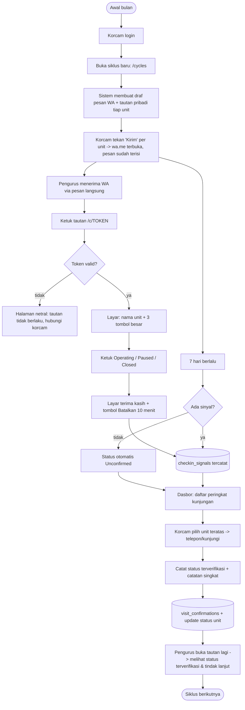

# 01 — User Flow (end-to-end)
Aktor: **Pengurus** (manager, tanpa akun), **Korcam** (login), **Pendamping DLH / Admin** (login, hak lebih).

## A. Alur besar satu siklus bulanan

## B. Rute dan layar
| # | Rute | Siapa | Tujuan |
|---|------|-------|--------|
| 1 | /c/[token] | Pengurus | Check-in 1 ketukan + lihat status/feedback |
| 2 | /login | Korcam/Admin | Masuk |
| 3 | /dashboard | Korcam/Admin | Daftar unit, status, peringkat kunjungan |
| 4 | /units/[id] | Korcam/Admin | Detail unit, riwayat sinyal & kunjungan, catat kunjungan |
| 5 | /cycles | Korcam/Admin | Buka siklus, draf WA, tandai terkirim, ekspor CSV |
| 6 | /settings | Admin | Bobot rumus, batas siklus, rotasi token |

## C. Urutan masuk pertama (onboarding korcam)
Login -> dasbor kosong (empty state: "Belum ada unit. Tambah unit pertama") -> tambah unit (nama, kelurahan, nomor WA pengurus) -> buka siklus -> kirim tautan.
Catatan: nomor WA pengurus = data kontak, bukan data warga; akses hanya korcam/admin.

## D. Alur kesalahan
- Token salah/kedaluwarsa/dicabut: halaman netral yang sama untuk semua kasus (tidak membocorkan mana yang benar).
- Pengurus ketuk dua kali: idempotent, sinyal terakhir dalam siklus yang sama menimpa, riwayat tetap tersimpan.
- Salah ketuk: tombol Batalkan 10 menit.
- Korcam mencatat status "Closed": minta konfirmasi dua langkah (tindakan arsip).
