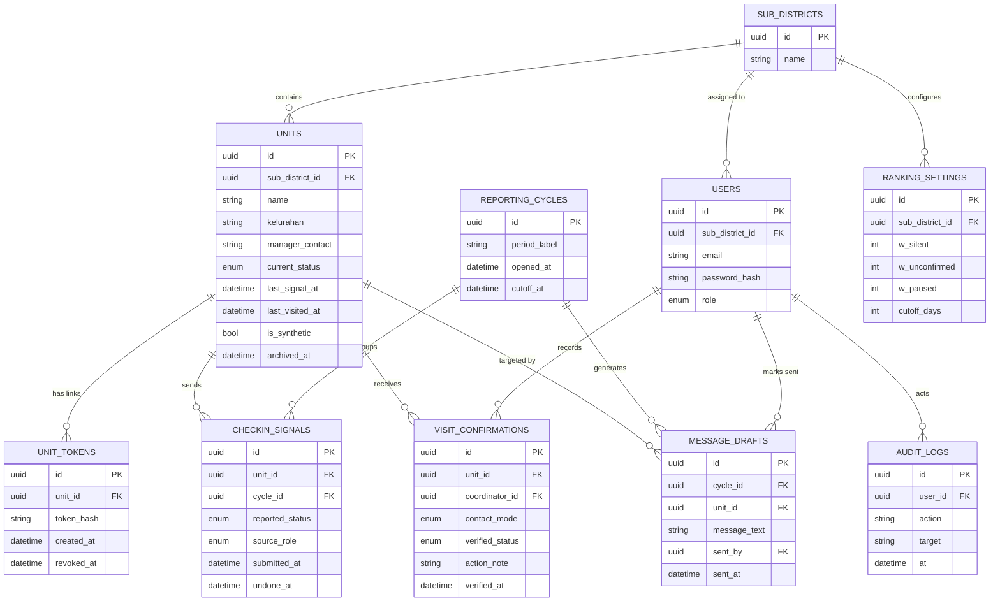

# 02 — ERD

## Catatan desain
- **unit_tokens dipisah dari units** (beda dengan skema proposal): token mentah tidak disimpan, hanya hash; bisa dirotasi/dicabut tanpa mengubah unit. Perbarui tabel di proposal 4.2 bila memakai ini.
- **current_status** adalah salinan turunan (denormalisasi) agar dasbor cepat; sumber kebenaran = checkin_signals + visit_confirmations.
- **Unconfirmed** tidak diinput manusia: dihitung saat cutoff_at lewat tanpa sinyal.
- **Tidak ada tabel nasabah/transaksi.** Zero resident PII.
- **ranking_settings** membuat bobot dan batas hari bisa diatur DLH (risiko "otoritas definisi aktif").
- Semua data demo: is_synthetic = true; UI menampilkan lencana "SIMULATED DATA".

## Aturan perubahan status
| Dari | Ke | Oleh |
|------|----|------|
| apa pun | Operating/Paused/Closed(usulan) | Pengurus (Closed hanya usulan -> perlu verifikasi korcam) |
| Unconfirmed | Operating/Paused/Closed | Korcam setelah kontak, atau pengurus |
| Operating/Paused | Unconfirmed | Sistem saat cutoff tanpa sinyal |
| Closed (terverifikasi) | Operating | Korcam saja (pembukaan kembali) |
