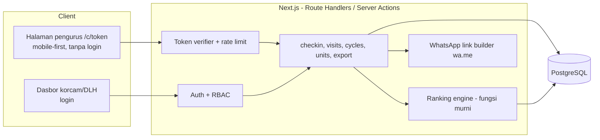

# 03 — Arsitektur (usulan; konfirmasi tim di docs/adr/0001-stack.md)

## Frontend
Next.js (App Router) + TypeScript + Tailwind. Dua area: publik-bertoken (`/c/[token]`) dan terproteksi (`(coordinator)/*`). Komponen kecil, tombol besar (min 56px), kontras tinggi, teks Indonesia sederhana. State di server; tanpa state manager besar.
## Backend
Route Handlers/Server Actions dengan validasi Zod. Lapisan: `lib/security` (token, rate limit) -> `lib/db` (Prisma) -> `lib/ranking` (fungsi murni, mudah dites) -> `lib/whatsapp` (susun URL wa.me, tanpa API berbayar). Cutoff siklus: dihitung saat baca (`cutoff_at < now` dan tanpa sinyal => Unconfirmed), jadi tidak butuh cron untuk MVP.
## Database
PostgreSQL + Prisma migrate. Hosting gratis (Neon/Supabase) untuk demo; `docker-compose` untuk fallback lokal (handbook Final Day meminta fallback lokal). Backup: ekspor CSV.
## Kenapa begini
Sederhana, bisa diserahterimakan ke operator DLH, tanpa biaya AI, tanpa data warga.
## Alur permintaan inti (check-in)
1. GET /c/[token] -> verifikasi hash -> render status (tanpa mengubah apa pun).
2. Ketuk tombol -> POST /api/checkin {token, status} -> validasi, rate limit, simpan sinyal, update current_status, audit.
3. Respons -> layar terima kasih + Batalkan (POST /api/checkin/undo dalam 10 menit).
## Env (tanpa rahasia di repo)
DATABASE_URL, AUTH_SECRET, APP_BASE_URL, TOKEN_PEPPER. Contoh di `.env.example`; rahasia tidak boleh di-commit.
