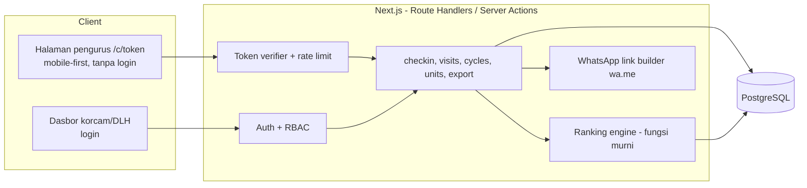
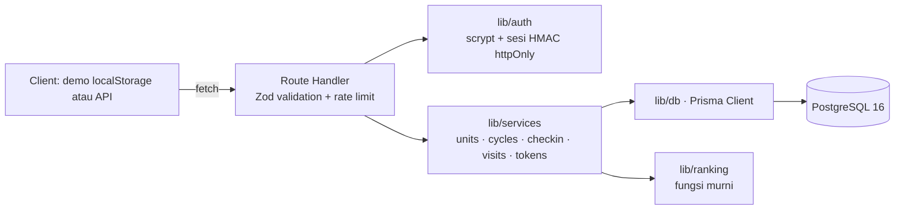
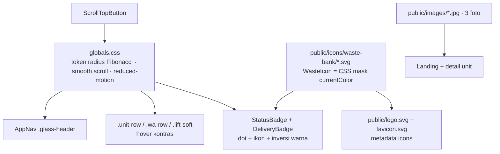

# 03 — Arsitektur (usulan; konfirmasi tim di docs/adr/0001-stack.md)

## Frontend
Next.js (App Router) + TypeScript + Tailwind. Dua area: publik-bertoken (`/c/[token]`) dan terproteksi (`(coordinator)/*`). Komponen kecil, tombol besar (min 56px), kontras tinggi, teks Indonesia sederhana. State di server; tanpa state manager besar.
## Backend
Route Handlers/Server Actions dengan validasi Zod. Lapisan: `lib/security` (token, rate limit) -> `lib/db` (Prisma) -> `lib/ranking` (fungsi murni, mudah dites) -> `lib/whatsapp` (susun URL wa.me, tanpa API berbayar). Cutoff siklus: dihitung saat baca (`cutoff_at < now` dan tanpa sinyal => Unconfirmed), jadi tidak butuh cron untuk MVP.
## Database
PostgreSQL + Prisma migrate. Hosting gratis (Neon/Supabase) untuk demo; `docker-compose` untuk fallback lokal (handbook Final Day meminta fallback lokal). Backup: ekspor CSV.
## Kenapa begini
Sederhana, bisa diserahterimakan ke operator DLH, tanpa biaya AI, tanpa data warga.
## Alur permintaan inti (check-in)
1. GET /c/[token] -> verifikasi hash -> render status (tanpa mengubah apa pun).
2. Ketuk tombol -> POST /api/checkin {token, status} -> validasi, rate limit, simpan sinyal, update current_status, audit.
3. Respons -> layar terima kasih + Batalkan (POST /api/checkin/undo dalam 10 menit).
## Env (tanpa rahasia di repo)
DATABASE_URL, DIRECT_URL (koneksi langsung untuk migrasi; di Neon = host non-pooled), AUTH_SECRET, APP_BASE_URL, TOKEN_PEPPER. Opsional untuk seed: SEED_ADMIN_*, SEED_COORDINATOR_*, SEED_ADVISOR_*. Contoh di `.env.example`; rahasia tidak boleh di-commit.

## Backend: PostgreSQL + Prisma (Arsitektur Dual-Mode Aktif)

Ruang lingkup: lapisan server penuh untuk alur inti, lengkap dengan jembatan `AppDataProvider` (`GET /api/health`). Saat `DATABASE_URL` tersedia, seluruh antarmuka (`/cycles`, `/dashboard`, `/units/[id]`, `/c/[token]`, `/settings`) otomatis berjalan dalam mode `api` dan melakukan operasi baca/tulis langsung ke PostgreSQL 16 melalui 14 Route Handlers bervalidasi Zod. Tanpa database (misalnya pada demo statis), sistem otomatis jatuh ke simulasi `localStorage` tanpa konfigurasi. Tidak ada AI/ML dan tidak ada tabel data pribadi warga.



### Struktur implementasi

| Lapisan | File | Tanggung jawab |
|---|---|---|
| HTTP | `src/app/api/**/route.ts` | Parsing JSON, validasi Zod, status code, header `no-store`/`noindex` |
| Auth | `src/lib/auth/{password,session-token,session,guard}.ts` | scrypt, token sesi HMAC 8 jam, cookie httpOnly, RBAC per kecamatan |
| Business | `src/lib/services/*` | Daftar unit + skor, rollover transaksional, check-in/undo, kunjungan, rotasi token |
| Data | `src/lib/db/client.ts`, `prisma/schema.prisma` | Prisma Client singleton + model PostgreSQL |
| Keamanan | `src/lib/security/{token,rate-limit,limiters}.ts` | Hash token SHA-256(+pepper), limiter per IP/token |
| Data awal | `prisma/migrations/20261127000000_init`, `prisma/seed.mjs` | Migrasi SQL awal + 30 unit sintetis, akun demo, siklus berjalan |

### Endpoint

| Method | Path | Akses | Catatan |
|---|---|---|---|
| GET | `/api/health` | publik | Deteksi mode UI: `api` bila PostgreSQL tersambung, jika tidak `demo` |
| POST | `/api/auth/login` | publik | scrypt + timing-safe; limiter 10/15 menit/IP |
| POST | `/api/auth/logout` · GET `/api/auth/me` | sesi | Cookie dihapus / profil sesi |
| GET | `/api/units` | COORDINATOR/ADVISOR/ADMIN | Skor dari `lib/ranking`; korcam otomatis difilter kecamatannya |
| POST | `/api/units/[id]/token` | COORDINATOR/ADMIN | Rotasi; token mentah dikembalikan **sekali**, DB hanya hash |
| POST | `/api/units/[id]/archive` | COORDINATOR/ADMIN | Status `CLOSED`, `archived_at`, semua token dicabut, audit |
| GET/POST | `/api/visits` | COORDINATOR/ADVISOR/ADMIN · tulis: COORDINATOR/ADMIN | Catat kontak/kunjungan + ubah status unit |
| GET/POST | `/api/checkin` | publik (token) | GET tidak pernah mengubah data; POST menyimpan sinyal |
| POST | `/api/checkin/undo` | publik (token) | Hanya ≤10 menit; memulihkan snapshot `previous_*` |
| GET/POST | `/api/cycles` | sesi · rollover: ADMIN | Rollover: unit tanpa sinyal → `UNCONFIRMED`, siklus ditutup, bulan berikutnya dibuka |
| POST | `/api/cycles/draft` | COORDINATOR/ADMIN | Tandai draf pesan WA sebagai terkirim pada siklus berjalan |
| GET/POST | `/api/settings` | sesi · tulis: ADMIN | Lihat/edit bobot per kecamatan (Zod: 0–10, cutoff 1–31 hari) + audit |
| GET | `/api/export` | sesi | CSV daftar prioritas (BOM UTF-8 untuk Excel) |

### Aturan yang ditegakkan

- **Token mentah tidak pernah disimpan/di-log.** Hanya `SHA-256(TOKEN_PEPPER + token)`; token acak 128-bit dibuat saat rotasi.
- **GET tidak memutasi data**, termasuk `/api/checkin` (aman untuk pratinjau tautan WhatsApp).
- **Rollover satu transaksi**: tandai unit diam, tutup siklus, buka siklus baru, tulis audit.
- **RBAC**: koordinator hanya kecamatannya; advisor lintas kecamatan (baca); admin boleh rollover.
- **Validasi**: semua body divalidasi Zod; galat dikembalikan sebagai `{ error: { code, message, details } }` tanpa stack trace.
- **Rate limit** in-memory per instance (cukup untuk demo; produksi multi-instance perlu Redis/Upstash).
- **Audit log** untuk check-in, undo, kunjungan, arsip, rotasi token, dan rollover.
- **Data seed sintetis** (`is_synthetic = true`), tanpa PII warga.

### Menjalankan database

```bash
cp .env.example .env      # isi AUTH_SECRET & TOKEN_PEPPER
docker compose up -d      # PostgreSQL 16 (docker-compose.yml)
npm run db:migrate        # prisma migrate dev
npm run db:seed           # 30 unit + akun demo
npm run db:studio         # opsional: lihat data
```

Verifikasi yang sudah dijalankan: `prisma validate` ✅, `prisma generate` ✅, migrasi SQL dihasilkan dari schema ✅, `npm run typecheck` ✅, `npm run build` ✅, `npm test` 28/28 ✅. Migrasi + seed juga **sudah dijalankan terhadap PostgreSQL 19 sungguhan** (27 Nov 2026): 30 unit, 30 token ter-hash, 3 akun, 13 sinyal awal berhasil dibuat. Smoke test endpoint: `GET /api/auth/me` (401 tanpa sesi), `POST /api/auth/login` (200 + cookie), `GET /api/units`, `GET/POST /api/checkin`, `POST /api/checkin/undo`, `POST /api/cycles` (rollover 14 unit → UNCONFIRMED, siklus 2026-12 dibuka), dan `GET /api/export` (CSV) semuanya 200/401 sesuai akses. Uji browser headless pada mode DB: `/dashboard` tanpa sesi dialihkan ke `/login` ✅, login koordinator berhasil ✅, dasbor menampilkan 30 unit + skor dari PostgreSQL ✅, halaman Pesan WA memuat siklus dari DB ✅, ketuk "Beroperasi" di `/c/[token]` menulis sinyal ke DB ✅, "Batalkan" memulihkan status ✅.

### Batasan saat ini

- `AppDataProvider` mendeteksi mode lewat `GET /api/health`. Tanpa `DATABASE_URL`, UI tetap memakai `localStorage` (demo). Dengan DB aktif, seluruh aksi halaman menjadi POST nyata dan `src/proxy.ts` melindungi area koordinator.
- Sesi stateless: mencabut satu sesi belum didukung (rotasi `AUTH_SECRET` membatalkan semua).
- Rollover belum dijadwalkan otomatis (cron); saat ini dipicu `POST /api/cycles` oleh admin.
- Tautan check-in hanya bisa ditampilkan sekali saat rotasi. UI Pesan WA perlu memanggil endpoint rotasi atau menyimpan tautan di sisi klien sampai terkirim.
- Form edit bobot sudah tersedia, tetapi nilainya tetap **heuristik yang belum divalidasi lapangan** (data sintetis). UI memberi label "visualisasi simulasi, angka dummy, bukan rekomendasi operasional". Di mode demo tanpa database, form tetap tampil sebagai visualisasi POV DLH; perubahan hanya tersimpan di `localStorage` dan diberi label demikian. Di mode DB, hanya ADMIN yang boleh menulis ke `ranking_settings`.

## Technical design: lapisan presentasi dan interaksi (sudah diterapkan di prototipe)

Ruang lingkup: **kosmetik dan interaksi saja**. Tidak mengubah alur empat layar, kontrak GET/POST, rumus `src/lib/ranking`, skema Prisma, atau status fitur di README. Tidak ada AI/ML, tidak ada data pribadi baru, dan tidak ada dependency runtime baru.



### Token dan perilaku

| Aspek | Implementasi | Catatan |
|---|---|---|
| Radius Fibonacci | `--radius-fib1…fib6` = **3 / 5 / 8 / 13 / 21 / 34 px**; `--radius-4xl` = 55 px; `--radius` root = 8 px | Satu skala untuk kartu, tombol, input, badge, dialog, phone mock-up, dan mark logo (13 px). Menggantikan sudut `rounded-lg/xl/2xl` yang tersebar. |
| Header kaca | `.glass-header`: putih 42% + `backdrop-filter: blur(21px) saturate(165%)`; saat `data-scrolled="true"` → putih 86% + shadow `0 13px 34px -21px` | `AppNav` memakai listener `scroll` pasif, ambang 8 px. Transisi 200 ms. |
| Hover baris | `.unit-row:hover`, `.wa-row:hover`: latar `--color-green-dark`, inset kiri 3 px `--color-green-light`, teks turunan `#f0faf4` | `.contrast-badge` / `.row-chip` berubah ke putih 14% + border putih 35%; `.row-action` jadi `--color-green-mid` + teks putih agar tombol tetap terbaca. |
| Hover kartu | `.lift-soft:hover`: `translateY(-3px)` + shadow `0 21px 34px -21px` | Group bernama `group/kpi`, `group/priority`, `group/step`, `group/status`, `group/stat` mengubah permukaan ke hijau tua dan teks/chip ke putih atau `green-pale`. |
| Badge status | `StatusBadge`: dot + ikon + teks; hover membalik ke warna status solid dengan teks putih | `DeliveryBadge` mengikuti pola yang sama untuk "Terkirim" / "Siap Draf" di layar Pesan WA. Tidak pernah hanya memakai warna. |
| Smooth scroll | `html { scroll-behavior: smooth; scroll-padding-top: 5.5rem }`, `section[id] { scroll-margin-top: 5.5rem }` | Anchor `#alur` tidak tertutup header sticky. `ScrollTopButton` muncul setelah 480 px dan memakai `window.scrollTo({ behavior: "smooth" })`. |
| Reduced motion | `html { scroll-behavior: auto !important }`, `transition/animation: none`, translate hover dimatikan | Memakai `prefers-reduced-motion: reduce`; tidak ada konten yang tersembunyi permanen. |
| Fokus | `:focus-visible` outline 3 px `#40916c`, offset 2 px, radius 8 px | Tidak diubah dari sistem sebelumnya. |
| Jarak antar tombol | `DialogFooter` memakai `gap-3` (12 px) di semua breakpoint; grup tombol pasangan/aksi memakai `gap-2`–`gap-3` | Sebelumnya `sm:gap-0` membuat tombol Batal/Simulasikan menempel di layar lebar; kini ada jarak tetap dan aman untuk sentuh. |
| Mockup perangkat | Bingkai iPhone CSS `aspect-[9/19.5]` (mis. 310×672 px), **dua lapis**: rail titanium 6 px + bezel hitam 4 px, dynamic island, tombol samping, status bar, dan home indicator | Mockup di layar Pesan WA memakai proporsi perangkat nyata, bukan kotak 340 px. Ketebalan frame 10 px per sisi agar proporsional pada lebar 310 px (sebelumnya 3 px terlihat terlalu tipis). Murni CSS tanpa file gambar perangkat, tetap tajam dan responsif (`max-w-[310px]`). |

### Peta komponen

| File | Peran |
|---|---|
| `src/app/globals.css` | Token warna/radius, `.glass-header`, lapisan interaksi (`.unit-row`, `.wa-row`, `.contrast-badge`, `.row-chip`, `.row-action`, `.lift-soft`), reduced-motion |
| `src/components/coordinator/AppNav.tsx` | Header scroll-aware, state aktif berkontras, pemasangan `logo.svg` |
| `src/components/common/StatusBadge.tsx` | Badge 4 status + properti `className` untuk `group-hover/*` |
| `src/components/common/DeliveryBadge.tsx` | Badge status pengiriman draf WA |
| `src/components/common/WasteIcon.tsx` | CSS mask dari file SVG publik; `bg-current` membuat ikon mewarisi warna teks dan hover |
| `src/components/common/ScrollTopButton.tsx` | Kontrol kembali ke atas |
| `src/app/layout.tsx` | `metadata.icons` → `favicon.svg`, Provider data global |
| `src/app/page.tsx` + `src/components/landing/*` | Landing dipecah per section; teks/data ada di `landing/content.tsx` |
| `src/components/ui/*` | Primitive shadcn (huruf kecil), dipisah dari komponen aplikasi di `common/` |
| `DashboardClient`, `CyclesClient`, `UnitDetailClient`, `BigChoiceButton`, `CheckinClient` | Penerapan hover kontras, chip, dan sudut Fibonacci pada tabel, kartu, form, dan tombol |
| `SettingsClient.tsx` | Workspace admin: editor bobot + panel nilai aktif/catatan/status. Field 48 px dengan label terlihat, validasi di bawah field, satu baris status, hover/focus mengikuti sistem. Teks kebijakan tetap jujur (heuristik belum divalidasi, angka dummy) |

### Aset yang dipakai

| Aset | Lokasi | Pemakaian |
|---|---|---|
| 3 foto (`komunitas-pemilahan-pkk`, `verifikasi-petugas-lapangan`, `unit-fisik-bank-sampah`) | `public/images/` | Hero, dua featured section, dan halaman detail unit. Hanya ditambah hover zoom `1.03`; tidak ada foto baru. |
| 6 ikon waste-bank (`organic-leaf`, `community-trust`, `scale-weighing`, `recycle-loop`, `bottle-plastic`, `paper-box`) | `public/icons/waste-bank/` | Lewat `WasteIcon` (CSS mask): eyebrow hero, badge komunitas, kartu alur prioritas/loop, judul rumus, chip material, logo footer. |
| `logo.svg`, `favicon.svg` | `public/` | Mark turunan `recycle-loop.svg`; dipakai di header/footer dan sebagai favicon. Radius 13 px, palet existing. |
| Ikon antarmuka (Lucide + 6 SVG waste-bank) | `lucide-react`, `WasteIcon` | **Tidak ada emoji bawaan sistem** di teks UI. Ikon mengikuti `currentColor` sehingga inversi kontras saat hover tetap berlaku. Tidak ada aset pihak ketiga yang ditambahkan. |

### Batasan dan non-goal

- Ranking tetap rumus deterministik; tidak ada model AI/ML dan tidak ada prediksi.
- Tidak ada perubahan skema → `docs/02-ERD.md` tidak perlu diubah.
- Saat berjalan tanpa `DATABASE_URL` (mode demo statis), state prototipe disimpan di `localStorage` lewat `lib/demo/store`; saat `DATABASE_URL` aktif, state dikelola penuh oleh server PostgreSQL melalui `AppDataProvider` dan Route Handlers.
- Perubahan status tetap hanya lewat POST; render GET tidak memutasi data.
- Chip material pada foto infrastruktur hanya label umum yang selaras dengan tulisan yang memang terlihat di foto (`BOTOL PLASTIK`, `KERTAS`, `DAUN`), bukan angka lapangan.
- Teks UI memakai tanda baca alami (titik, koma, titik dua). Em dash dan double dash tidak dipakai di teks yang dirender; yang tersisa hanya di komentar kode.
- Mark logo adalah desain prototipe, **bukan logo resmi DLH**; harus diganti bila tim memiliki aset resmi.

### Verifikasi

`npm run typecheck` ✅ · `npm run build` ✅ · `npm test` 21/21 ✅. Pengecekan visual headless Chrome pada lebar 1440 px mencakup hero, dasbor, dan Pesan WA; simulasi hover via CDP pada kartu KPI, kartu prioritas, dan baris tabel mengonfirmasi inversi kontras. Tag `<link rel="icon" href="/favicon.svg">` hadir di HTML yang disajikan.
