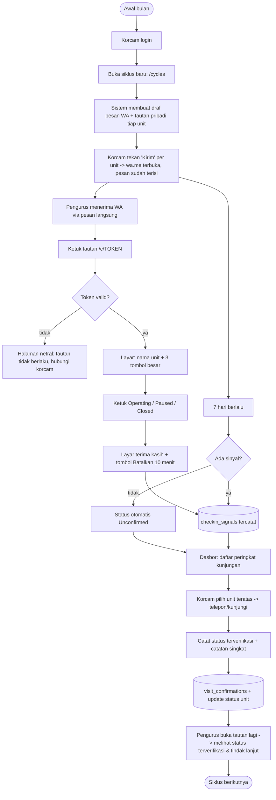
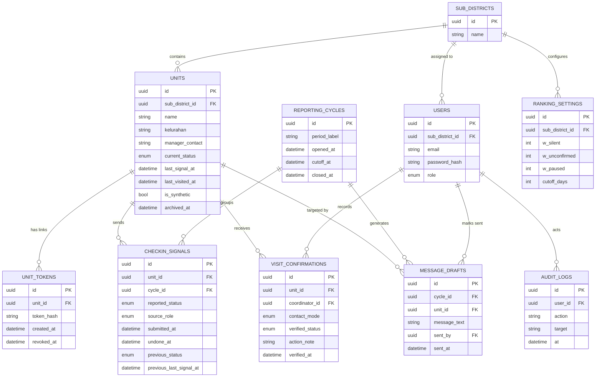
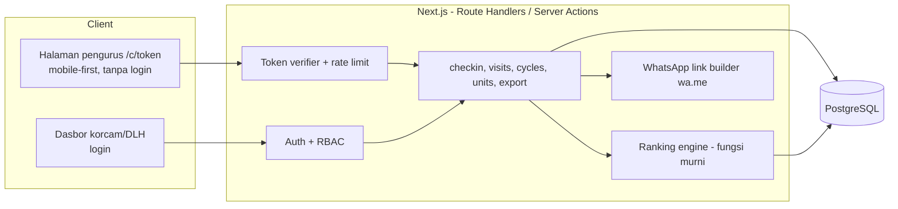
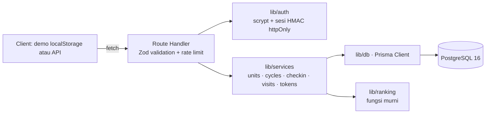
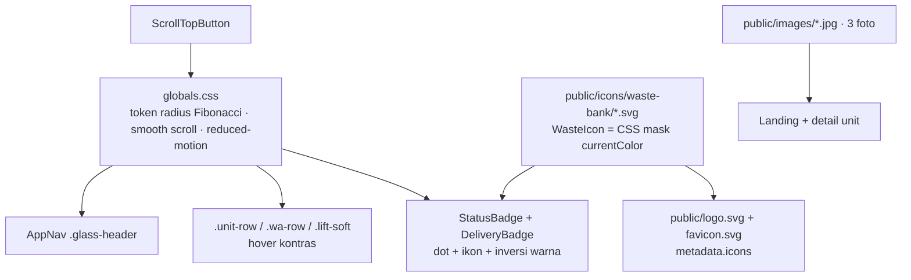

# Technical Design — Pilah & Kunjung

> Prototipe STACK 2026 · Case 2 · RumaSynapse Corp. · Pilot Kecamatan Gunungpati.
> **Semua data = SINTETIS.** Tidak ada bank sampah asli, tidak ada data warga. Tidak ada AI/ML di dalam produk.

Dokumen gabungan ini menyatukan `docs/00` sampai `docs/10` serta `docs/adr/0001` menjadi satu Markdown agar bisa diekspor sebagai **satu PDF**. **Source of truth tetap file asal** — setelah mengubah docs, jalankan `npm run docs:build` untuk regenerate.

Contoh ekspor: `pandoc docs/TECHNICAL-DESIGN.md -o technical-design.pdf --number-sections` atau ekstensi *Markdown PDF* di VS Code. Renderer harus mendukung diagram Mermaid.

## Daftar isi

- [00 — Project Brief](#doc-00)
- [01 — User Flow (end-to-end)](#doc-01)
- [02 — ERD](#doc-02)
- [03 — Arsitektur (usulan; konfirmasi tim di docs/adr/0001-stack.md)](#doc-03)
- [04 — Keamanan dari sudut UI/UX (berurutan mengikuti ERD)](#doc-04)
- [05 — Spesifikasi Layar](#doc-05)
- [06 — Logika Peringkat Kunjungan (deterministik, tanpa AI)](#doc-06)
- [07 — Rundown Pengerjaan per Role](#doc-07)
- [08 — Tugas Substantif Final Day (16 Des)](#doc-08)
- [09 — Pengungkapan Bantuan AI (isi dan perbarui jujur)](#doc-09)
- [10 — Git (commit, push, merge) dan deploy Vercel gratis](#doc-10)
- [ADR 0001 — Pilihan stack (STATUS: USULAN, tim konfirmasi)](#adr-0001)

---

<a id="doc-00"></a>

# 00 — Project Brief
**Masalah:** Unit bank sampah Semarang berbasis relawan; DLH punya 4 pendamping untuk 16 kecamatan. Unit yang diam tampak sama, entah mati suri atau sibuk.
**Solusi:** Web ringan: pengurus ketuk 1 status/bulan (Operating/Paused/Closed) lewat tautan pribadi; korcam melihat status + daftar prioritas kunjungan; hasil kontak/kunjungan dicatat dan terlihat kembali oleh pengurus.
**Bukan:** pembukuan nasabah, hitung tonase, WhatsApp Business API massal, AI.
**Pengguna:** Utama = korcam Gunungpati + pendamping DLH. Sekunder = pengurus unit.
**Definisi status:** lihat proposal 3.2 (Operating, Paused, Closed, Unconfirmed).
**Yang harus jujur di semifinal:** data sintetis, tes disimulasikan, alasan tidak melapor di Semarang masih asumsi.

---

<a id="doc-01"></a>

# 01 — User Flow (end-to-end)
Aktor: **Pengurus** (manager, tanpa akun), **Korcam** (login), **Pendamping DLH / Admin** (login, hak lebih).

## A. Alur besar satu siklus bulanan


## B. Rute dan layar
| # | Rute | Siapa | Tujuan |
|---|------|-------|--------|
| 1 | /c/[token] | Pengurus | Check-in 1 ketukan + lihat status/feedback |
| 2 | /login | Korcam/Admin | Masuk |
| 3 | /dashboard | Korcam/Admin | Daftar unit, status, peringkat kunjungan |
| 4 | /units/[id] | Korcam/Admin | Detail unit, riwayat sinyal & kunjungan, catat kunjungan |
| 5 | /cycles | Korcam/Admin | Buka siklus, draf WA, tandai terkirim, ekspor CSV |
| 6 | /settings | Admin | Bobot rumus, batas siklus, rotasi token |

## C. Urutan masuk pertama (onboarding korcam)
Login -> dasbor kosong (empty state: "Belum ada unit. Tambah unit pertama") -> tambah unit (nama, kelurahan, nomor WA pengurus) -> buka siklus -> kirim tautan.
Catatan: nomor WA pengurus = data kontak, bukan data warga; akses hanya korcam/admin.

## D. Alur kesalahan
- Token salah/kedaluwarsa/dicabut: halaman netral yang sama untuk semua kasus (tidak membocorkan mana yang benar).
- Pengurus ketuk dua kali: idempotent, sinyal terakhir dalam siklus yang sama menimpa, riwayat tetap tersimpan.
- Salah ketuk: tombol Batalkan 10 menit.
- Korcam mencatat status "Closed": minta konfirmasi dua langkah (tindakan arsip).

---

<a id="doc-02"></a>

# 02 — ERD

## Catatan desain
- **unit_tokens dipisah dari units** (beda dengan skema proposal): token mentah tidak disimpan, hanya hash; bisa dirotasi/dicabut tanpa mengubah unit. Perbarui tabel di proposal 4.2 bila memakai ini.
- **current_status** adalah salinan turunan (denormalisasi) agar dasbor cepat; sumber kebenaran = checkin_signals + visit_confirmations.
- **Unconfirmed** tidak diinput manusia: dihitung saat cutoff_at lewat tanpa sinyal.
- **Tidak ada tabel nasabah/transaksi.** Zero resident PII.
- **ranking_settings** membuat bobot dan batas hari bisa diatur DLH (risiko "otoritas definisi aktif").
- Semua data demo: is_synthetic = true; UI menampilkan lencana "SIMULATED DATA".
- **Implementasi Prisma (27 Nov 2026):** `reporting_cycles.closed_at` menandai siklus yang sudah ditutup saat rollover; `checkin_signals.previous_status` + `previous_last_signal_at` menyimpan snapshot agar "Batalkan 10 menit" bisa memulihkan status. Semua model punya index untuk query dasbor (`units.sub_district_id`, `units.current_status`, `checkin_signals.cycle_id`, `visit_confirmations.unit_id,verified_at`). `message_drafts` unik per `(cycle_id, unit_id)`. Migrasi awal: `prisma/migrations/20261127000000_init`.

## Aturan perubahan status
| Dari | Ke | Oleh |
|------|----|------|
| apa pun | Operating/Paused/Closed(usulan) | Pengurus (Closed hanya usulan -> perlu verifikasi korcam) |
| Unconfirmed | Operating/Paused/Closed | Korcam setelah kontak, atau pengurus |
| Operating/Paused | Unconfirmed | Sistem saat cutoff tanpa sinyal |
| Closed (terverifikasi) | Operating | Korcam saja (pembukaan kembali) |

---

<a id="doc-03"></a>

# 03 — Arsitektur (usulan; konfirmasi tim di docs/adr/0001-stack.md)

## Frontend
Next.js (App Router) + TypeScript + Tailwind. Dua area: publik-bertoken (`/c/[token]`) dan terproteksi (`(coordinator)/*`). Komponen kecil, tombol besar (min 56px), kontras tinggi, teks Indonesia sederhana. State di server; tanpa state manager besar.
## Backend
Route Handlers/Server Actions dengan validasi Zod. Lapisan: `lib/security` (token, rate limit) -> `lib/db` (Prisma) -> `lib/ranking` (fungsi murni, mudah dites) -> `lib/whatsapp` (susun URL wa.me, tanpa API berbayar). Cutoff siklus: dihitung saat baca (`cutoff_at < now` dan tanpa sinyal => Unconfirmed), jadi tidak butuh cron untuk MVP.
## Database
PostgreSQL + Prisma migrate. Hosting gratis (Neon/Supabase) untuk demo; `docker-compose` untuk fallback lokal (handbook Final Day meminta fallback lokal). Backup: ekspor CSV.
## Kenapa begini
Sederhana, bisa diserahterimakan ke operator DLH, tanpa biaya AI, tanpa data warga.
## Alur permintaan inti (check-in)
1. GET /c/[token] -> verifikasi hash -> render status (tanpa mengubah apa pun).
2. Ketuk tombol -> POST /api/checkin {token, status} -> validasi, rate limit, simpan sinyal, update current_status, audit.
3. Respons -> layar terima kasih + Batalkan (POST /api/checkin/undo dalam 10 menit).
## Env (tanpa rahasia di repo)
DATABASE_URL, DIRECT_URL (koneksi langsung untuk migrasi; di Neon = host non-pooled), AUTH_SECRET, APP_BASE_URL, TOKEN_PEPPER. Opsional untuk seed: SEED_ADMIN_*, SEED_COORDINATOR_*, SEED_ADVISOR_*. Contoh di `.env.example`; rahasia tidak boleh di-commit.

## Backend — PostgreSQL + Prisma (API aktif; UI beralih otomatis bila DB tersedia)

Ruang lingkup: lapisan server nyata untuk alur inti. UI dashboard/Pesan WA/check-in **masih** memakai state demo di browser; migrasi UI ke API adalah fase berikutnya. Tidak ada AI/ML dan tidak ada tabel data pribadi warga.



### Struktur implementasi

| Lapisan | File | Tanggung jawab |
|---|---|---|
| HTTP | `src/app/api/**/route.ts` | Parsing JSON, validasi Zod, status code, header `no-store`/`noindex` |
| Auth | `src/lib/auth/{password,session-token,session,guard}.ts` | scrypt, token sesi HMAC 8 jam, cookie httpOnly, RBAC per kecamatan |
| Business | `src/lib/services/*` | Daftar unit + skor, rollover transaksional, check-in/undo, kunjungan, rotasi token |
| Data | `src/lib/db/client.ts`, `prisma/schema.prisma` | Prisma Client singleton + model PostgreSQL |
| Keamanan | `src/lib/security/{token,rate-limit,limiters}.ts` | Hash token SHA-256(+pepper), limiter per IP/token |
| Data awal | `prisma/migrations/20261127000000_init`, `prisma/seed.mjs` | Migrasi SQL awal + 30 unit sintetis, akun demo, siklus berjalan |

### Endpoint

| Method | Path | Akses | Catatan |
|---|---|---|---|
| GET | `/api/health` | publik | Deteksi mode UI: `api` bila PostgreSQL tersambung, jika tidak `demo` |
| POST | `/api/auth/login` | publik | scrypt + timing-safe; limiter 10/15 menit/IP |
| POST | `/api/auth/logout` · GET `/api/auth/me` | sesi | Cookie dihapus / profil sesi |
| GET | `/api/units` | COORDINATOR/ADVISOR/ADMIN | Skor dari `lib/ranking`; korcam otomatis difilter kecamatannya |
| POST | `/api/units/[id]/token` | COORDINATOR/ADMIN | Rotasi; token mentah dikembalikan **sekali**, DB hanya hash |
| POST | `/api/units/[id]/archive` | COORDINATOR/ADMIN | Status `CLOSED`, `archived_at`, semua token dicabut, audit |
| GET/POST | `/api/visits` | COORDINATOR/ADVISOR/ADMIN · tulis: COORDINATOR/ADMIN | Catat kontak/kunjungan + ubah status unit |
| GET/POST | `/api/checkin` | publik (token) | GET tidak pernah mengubah data; POST menyimpan sinyal |
| POST | `/api/checkin/undo` | publik (token) | Hanya ≤10 menit; memulihkan snapshot `previous_*` |
| GET/POST | `/api/cycles` | sesi · rollover: ADMIN | Rollover: unit tanpa sinyal → `UNCONFIRMED`, siklus ditutup, bulan berikutnya dibuka |
| POST | `/api/cycles/draft` | COORDINATOR/ADMIN | Tandai draf pesan WA sebagai terkirim pada siklus berjalan |
| GET/POST | `/api/settings` | sesi · tulis: ADMIN | Lihat/edit bobot per kecamatan (Zod: 0–10, cutoff 1–31 hari) + audit |
| GET | `/api/export` | sesi | CSV daftar prioritas (BOM UTF-8 untuk Excel) |

### Aturan yang ditegakkan

- **Token mentah tidak pernah disimpan/di-log.** Hanya `SHA-256(TOKEN_PEPPER + token)`; token acak 128-bit dibuat saat rotasi.
- **GET tidak memutasi data**, termasuk `/api/checkin` (aman untuk pratinjau tautan WhatsApp).
- **Rollover satu transaksi**: tandai unit diam, tutup siklus, buka siklus baru, tulis audit.
- **RBAC**: koordinator hanya kecamatannya; advisor lintas kecamatan (baca); admin boleh rollover.
- **Validasi**: semua body divalidasi Zod; galat dikembalikan sebagai `{ error: { code, message, details } }` tanpa stack trace.
- **Rate limit** in-memory per instance (cukup untuk demo; produksi multi-instance perlu Redis/Upstash).
- **Audit log** untuk check-in, undo, kunjungan, arsip, rotasi token, dan rollover.
- **Data seed sintetis** (`is_synthetic = true`), tanpa PII warga.

### Menjalankan database

```bash
cp .env.example .env      # isi AUTH_SECRET & TOKEN_PEPPER
docker compose up -d      # PostgreSQL 16 (docker-compose.yml)
npm run db:migrate        # prisma migrate dev
npm run db:seed           # 30 unit + akun demo
npm run db:studio         # opsional: lihat data
```

Verifikasi yang sudah dijalankan: `prisma validate` ✅, `prisma generate` ✅, migrasi SQL dihasilkan dari schema ✅, `npm run typecheck` ✅, `npm run build` ✅, `npm test` 28/28 ✅. Migrasi + seed juga **sudah dijalankan terhadap PostgreSQL 19 sungguhan** (27 Nov 2026): 30 unit, 30 token ter-hash, 3 akun, 13 sinyal awal berhasil dibuat. Smoke test endpoint: `GET /api/auth/me` (401 tanpa sesi), `POST /api/auth/login` (200 + cookie), `GET /api/units`, `GET/POST /api/checkin`, `POST /api/checkin/undo`, `POST /api/cycles` (rollover 14 unit → UNCONFIRMED, siklus 2026-12 dibuka), dan `GET /api/export` (CSV) semuanya 200/401 sesuai akses. Uji browser headless pada mode DB: `/dashboard` tanpa sesi dialihkan ke `/login` ✅, login koordinator berhasil ✅, dasbor menampilkan 30 unit + skor dari PostgreSQL ✅, halaman Pesan WA memuat siklus dari DB ✅, ketuk "Beroperasi" di `/c/[token]` menulis sinyal ke DB ✅, "Batalkan" memulihkan status ✅.

### Batasan saat ini

- `AppDataProvider` mendeteksi mode lewat `GET /api/health`. Tanpa `DATABASE_URL`, UI tetap memakai `localStorage` (demo). Dengan DB aktif, seluruh aksi halaman menjadi POST nyata dan `src/proxy.ts` melindungi area koordinator.
- Sesi stateless: mencabut satu sesi belum didukung (rotasi `AUTH_SECRET` membatalkan semua).
- Rollover belum dijadwalkan otomatis (cron); saat ini dipicu `POST /api/cycles` oleh admin.
- Tautan check-in hanya bisa ditampilkan sekali saat rotasi. UI Pesan WA perlu memanggil endpoint rotasi atau menyimpan tautan di sisi klien sampai terkirim.
- Form edit bobot sudah tersedia, tetapi nilainya tetap **heuristik yang belum divalidasi lapangan** (data sintetis). UI memberi label "visualisasi simulasi — angka dummy, bukan rekomendasi operasional". Di mode demo tanpa database, form tetap tampil sebagai visualisasi POV DLH; perubahan hanya tersimpan di `localStorage` dan diberi label demikian. Di mode DB, hanya ADMIN yang boleh menulis ke `ranking_settings`.

## Technical design — lapisan presentasi & interaksi (sudah diterapkan di prototipe)

Ruang lingkup: **kosmetik dan interaksi saja**. Tidak mengubah alur empat layar, kontrak GET/POST, rumus `src/lib/ranking`, skema Prisma, atau status fitur di README. Tidak ada AI/ML, tidak ada data pribadi baru, dan tidak ada dependency runtime baru.



### Token dan perilaku

| Aspek | Implementasi | Catatan |
|---|---|---|
| Radius Fibonacci | `--radius-fib1…fib6` = **3 / 5 / 8 / 13 / 21 / 34 px**; `--radius-4xl` = 55 px; `--radius` root = 8 px | Satu skala untuk kartu, tombol, input, badge, dialog, phone mock-up, dan mark logo (13 px). Menggantikan sudut `rounded-lg/xl/2xl` yang tersebar. |
| Header kaca | `.glass-header`: putih 42% + `backdrop-filter: blur(21px) saturate(165%)`; saat `data-scrolled="true"` → putih 86% + shadow `0 13px 34px -21px` | `AppNav` memakai listener `scroll` pasif, ambang 8 px. Transisi 200 ms. |
| Hover baris | `.unit-row:hover`, `.wa-row:hover`: latar `--color-green-dark`, inset kiri 3 px `--color-green-light`, teks turunan `#f0faf4` | `.contrast-badge` / `.row-chip` berubah ke putih 14% + border putih 35%; `.row-action` jadi `--color-green-mid` + teks putih agar tombol tetap terbaca. |
| Hover kartu | `.lift-soft:hover`: `translateY(-3px)` + shadow `0 21px 34px -21px` | Group bernama `group/kpi`, `group/priority`, `group/step`, `group/status`, `group/stat` mengubah permukaan ke hijau tua dan teks/chip ke putih atau `green-pale`. |
| Badge status | `StatusBadge`: dot + ikon + teks; hover membalik ke warna status solid dengan teks putih | `DeliveryBadge` mengikuti pola yang sama untuk "Terkirim" / "Siap Draf" di layar Pesan WA. Tidak pernah hanya memakai warna. |
| Smooth scroll | `html { scroll-behavior: smooth; scroll-padding-top: 5.5rem }`, `section[id] { scroll-margin-top: 5.5rem }` | Anchor `#alur` tidak tertutup header sticky. `ScrollTopButton` muncul setelah 480 px dan memakai `window.scrollTo({ behavior: "smooth" })`. |
| Reduced motion | `html { scroll-behavior: auto !important }`, `transition/animation: none`, translate hover dimatikan | Memakai `prefers-reduced-motion: reduce`; tidak ada konten yang tersembunyi permanen. |
| Fokus | `:focus-visible` outline 3 px `#40916c`, offset 2 px, radius 8 px | Tidak diubah dari sistem sebelumnya. |
| Jarak antar tombol | `DialogFooter` memakai `gap-3` (12 px) di semua breakpoint; grup tombol pasangan/aksi memakai `gap-2`–`gap-3` | Sebelumnya `sm:gap-0` membuat tombol Batal/Simulasikan menempel di layar lebar; kini ada jarak tetap dan aman untuk sentuh. |
| Mockup perangkat | Bingkai iPhone CSS `aspect-[9/19.5]` (mis. 310×672 px), **dua lapis**: rail titanium 6 px + bezel hitam 4 px, dynamic island, tombol samping, status bar, dan home indicator | Mockup di layar Pesan WA memakai proporsi perangkat nyata, bukan kotak 340 px. Ketebalan frame 10 px per sisi agar proporsional pada lebar 310 px (sebelumnya 3 px terlihat terlalu tipis). Murni CSS — tanpa file gambar perangkat, tetap tajam dan responsif (`max-w-[310px]`). |

### Peta komponen

| File | Peran |
|---|---|
| `src/app/globals.css` | Token warna/radius, `.glass-header`, lapisan interaksi (`.unit-row`, `.wa-row`, `.contrast-badge`, `.row-chip`, `.row-action`, `.lift-soft`), reduced-motion |
| `src/components/coordinator/AppNav.tsx` | Header scroll-aware, state aktif berkontras, pemasangan `logo.svg` |
| `src/components/common/StatusBadge.tsx` | Badge 4 status + properti `className` untuk `group-hover/*` |
| `src/components/common/DeliveryBadge.tsx` | Badge status pengiriman draf WA |
| `src/components/common/WasteIcon.tsx` | CSS mask dari file SVG publik; `bg-current` membuat ikon mewarisi warna teks dan hover |
| `src/components/common/ScrollTopButton.tsx` | Kontrol kembali ke atas |
| `src/app/layout.tsx` | `metadata.icons` → `favicon.svg`, Provider data global |
| `src/app/page.tsx` + `src/components/landing/*` | Landing dipecah per section; teks/data ada di `landing/content.tsx` |
| `src/components/ui/*` | Primitive shadcn (huruf kecil), dipisah dari komponen aplikasi di `common/` |
| `DashboardClient`, `CyclesClient`, `UnitDetailClient`, `BigChoiceButton`, `CheckinClient` | Penerapan hover kontras, chip, dan sudut Fibonacci pada tabel, kartu, form, dan tombol |
| `SettingsClient.tsx` | Workspace admin: editor bobot + panel nilai aktif/catatan/status. Field 48 px dengan label terlihat, validasi di bawah field, satu baris status, hover/focus mengikuti sistem. Teks kebijakan tetap jujur (heuristik belum divalidasi, angka dummy) |

### Aset yang dipakai

| Aset | Lokasi | Pemakaian |
|---|---|---|
| 3 foto (`komunitas-pemilahan-pkk`, `verifikasi-petugas-lapangan`, `unit-fisik-bank-sampah`) | `public/images/` | Hero, dua featured section, dan halaman detail unit. Hanya ditambah hover zoom `1.03`; tidak ada foto baru. |
| 6 ikon waste-bank (`organic-leaf`, `community-trust`, `scale-weighing`, `recycle-loop`, `bottle-plastic`, `paper-box`) | `public/icons/waste-bank/` | Lewat `WasteIcon` (CSS mask): eyebrow hero, badge komunitas, kartu alur prioritas/loop, judul rumus, chip material, logo footer. |
| `logo.svg`, `favicon.svg` | `public/` | Mark turunan `recycle-loop.svg`; dipakai di header/footer dan sebagai favicon. Radius 13 px, palet existing. |
| Ikon antarmuka (Lucide + 6 SVG waste-bank) | `lucide-react`, `WasteIcon` | **Tidak ada emoji bawaan sistem** di teks UI. Ikon mengikuti `currentColor` sehingga inversi kontras saat hover tetap berlaku. Tidak ada aset pihak ketiga yang ditambahkan. |

### Batasan dan non-goal

- Ranking tetap rumus deterministik; tidak ada model AI/ML dan tidak ada prediksi.
- Tidak ada perubahan skema → `docs/02-ERD.md` tidak perlu diubah.
- State demo prototipe masih di `localStorage` lewat `lib/demo/store`; target state di server (bagian Backend di atas) belum diimplementasikan.
- Perubahan status tetap hanya lewat POST; render GET tidak memutasi data.
- Chip material pada foto infrastruktur hanya label umum yang selaras dengan tulisan yang memang terlihat di foto (`BOTOL PLASTIK`, `KERTAS`, `DAUN`), bukan angka lapangan.
- Teks UI memakai tanda baca alami (titik, koma, titik dua). Em dash dan double dash tidak dipakai di teks yang dirender; yang tersisa hanya di komentar kode.
- Mark logo adalah desain prototipe, **bukan logo resmi DLH**; harus diganti bila tim memiliki aset resmi.

### Verifikasi

`npm run typecheck` ✅ · `npm run build` ✅ · `npm test` 21/21 ✅. Pengecekan visual headless Chrome pada lebar 1440 px mencakup hero, dasbor, dan Pesan WA; simulasi hover via CDP pada kartu KPI, kartu prioritas, dan baris tabel mengonfirmasi inversi kontras. Tag `<link rel="icon" href="/favicon.svg">` hadir di HTML yang disajikan.

---

<a id="doc-04"></a>

# 04 — Keamanan dari sudut UI/UX (berurutan mengikuti ERD)
Prinsip: kontrol keamanan tidak boleh menambah beban pengurus (relawan, ada yang lansia).
| # | Ancaman | Kontrol teknis | Dampak UI/UX | Tabel terkait |
|---|---------|----------------|--------------|---------------|
| 1 | Tautan ditebak | Token acak 128-bit; simpan hash SHA-256 (+pepper) | Tautan panjang, dikirim lewat tombol WA, tidak diketik | unit_tokens |
| 2 | Tautan bocor di grup | Kirim per pesan langsung, bukan grup; tombol "Kirim" per unit; rotasi/cabut token | Korcam punya tombol "Cabut tautan" di /units/[id] | unit_tokens |
| 3 | Pratinjau WhatsApp/bot membuka tautan | GET tidak mengubah data; perubahan hanya lewat POST | Pengurus tetap harus mengetuk tombol | checkin_signals |
| 4 | Salah ketuk | Batalkan 10 menit (undone_at) | Toast "Batalkan" besar | checkin_signals |
| 5 | Kebocoran URL via referrer/mesin pencari | Referrer-Policy: no-referrer, X-Robots-Tag: noindex | Tidak terlihat | - |
| 6 | Brute force token | Rate limit per IP + per token; respons seragam | Halaman "tautan tidak berlaku" yang netral | audit_logs |
| 7 | Akun korcam diambil alih | Hash kata sandi (argon2/bcrypt), sesi httpOnly, CSRF | Login sederhana, pesan galat umum | users |
| 8 | Akses lintas kecamatan | RBAC: korcam hanya sub_district miliknya; admin lintas | Dasbor otomatis terfilter | users, sub_districts |
| 9 | Perubahan tidak terlacak | Audit log tindakan korcam/admin | Riwayat terlihat di /units/[id] | audit_logs, visit_confirmations |
| 10 | Data pribadi warga | Tidak ada tabel nasabah; nomor WA pengurus hanya untuk korcam/admin | Nomor disamarkan di layar pengurus | units |
| 11 | Salah mengarsipkan unit | Konfirmasi dua langkah untuk Closed | Dialog "Yakin tutup unit ini?" | units, visit_confirmations |
| 12 | Data simulasi terbaca sebagai nyata | Kolom is_synthetic + lencana | Lencana "SIMULATED DATA" di semua layar demo | units |
| 13 | Rahasia bocor di repo | .env, secret scanning, pesan commit bersih | - | - |
Catatan jujur: ini rancangan. Jangan tulis "aman" di proposal; tulis "dirancang dengan" dan sebutkan kontrol yang benar-benar sudah dibuat per tanggal itu.

---

<a id="doc-05"></a>

# 05 — Spesifikasi Layar
## 1. /c/[token] — Check-in pengurus (mobile-first)
- Header: nama unit, kelurahan. Lencana "SIMULATED DATA" bila demo.
- Pertanyaan: "Bagaimana kondisi bank sampah bulan ini?"
- 3 tombol besar (min 56px, ikon + teks): Beroperasi / Dijeda / Tutup.
- Setelah ketuk: "Terima kasih. Status bulan ini: Beroperasi." + [Batalkan] 10 menit.
- Bagian "Tindak lanjut": status terverifikasi korcam + catatan singkat + tanggal (umpan balik untuk pengurus).
- Keadaan: valid, sudah check-in, token tidak berlaku (netral), offline (pesan sederhana).
- Aksesibilitas: font >=18px, kontras tinggi, tanpa istilah teknis.
## 2. /login
Email + kata sandi, galat umum, tanpa pendaftaran mandiri (akun dibuat admin).
## 3. /dashboard
- Ringkasan: jumlah per status (Operating, Paused, Closed, Unconfirmed).
- Tabel: peringkat, nama unit, kelurahan, status, bulan diam, terakhir sinyal, terakhir dikunjungi, skor.
- Filter status, cari nama. Urut default = skor prioritas. Tooltip skor: "2×M + W + B" dengan rincian.
- Aksi per baris: Kirim pengingat WA, Catat kontak/kunjungan.
## 4. /units/[id]
Profil unit, riwayat sinyal, riwayat kunjungan, formulir catat (mode: Telepon/Kunjungan, status terverifikasi, catatan), tombol cabut/rotasi tautan.
## 5. /cycles
Buka siklus baru, daftar unit + tombol "Kirim via WhatsApp" (membuka wa.me terisi), penanda terkirim, ekspor CSV daftar kunjungan.
## 6. /settings (admin)
Bobot rumus, cutoff_days, daftar unit (tambah/arsip), pengguna.
## Komponen
StatusBadge, BigChoiceButton, UnitRow, ScoreTooltip, ConfirmDialog, SyntheticBanner, EmptyState.

Token radius Fibonacci, header kaca, badge status modern, smooth scroll, dan perilaku hover kontras dijelaskan di `docs/03-ARCHITECTURE.md` bagian "Technical design — lapisan presentasi & interaksi".

---

<a id="doc-06"></a>

# 06 — Logika Peringkat Kunjungan (deterministik, tanpa AI)
Heuristik awal usulan tim (belum divalidasi; bobot dikalibrasi bersama praktisi):
`Skor = 2 × M_diam + W_status + B_kunjungan`
- M_diam: jumlah siklus berturut-turut tanpa sinyal/verifikasi (0,1,2,...)
- W_status: Unconfirmed=3, Paused=2, Operating=0, Closed=dikecualikan
- B_kunjungan: +2 bila tidak ada kontak/kunjungan >6 bulan (atau tidak pernah); +1 bila 3–6 bulan; 0 lainnya
- Seri: last_signal_at lebih lama = peringkat lebih tinggi.
## Pseudocode
```ts
export function score(u: UnitInput, cfg: Cfg): number | null {
  if (u.status === 'CLOSED') return null;          // dikecualikan
  const w = { UNCONFIRMED: cfg.wUnconfirmed, PAUSED: cfg.wPaused, OPERATING: 0 }[u.status];
  const b = u.monthsSinceContact === null || u.monthsSinceContact > 6 ? 2
          : u.monthsSinceContact >= 3 ? 1 : 0;
  return cfg.wSilent * u.silentCycles + w + b;
}
```
## Contoh (data sintetis)
| Unit | M | Status | Kontak terakhir | Skor |
|------|---|--------|-----------------|------|
| A | 3 | Unconfirmed | tak pernah | 6+3+2 = 11 |
| B | 1 | Paused | 4 bulan | 2+2+1 = 5 |
| C | 0 | Operating | 1 bulan | 0 |
## Tes wajib (tests/ranking)
Closed dikecualikan; seri dipecah last_signal_at; bobot dari settings; batas 3 dan 6 bulan; unit tanpa riwayat.

---

<a id="doc-07"></a>

# 07 — Rundown Pengerjaan per Role
Role (USULAN, tim yang memutuskan): **A** Janerson = Lead/Arsitektur & penulis proposal. **B** Farritz = Frontend & UI/UX. **C** Farras = Backend & Database. **D** Hieronimus = Validasi, data sintetis, video.
Proposal saat ini mengklaim "clickable flow sudah dibangun" dan "dataset sintetis 30 unit" per 30 Nov. Keduanya HARUS benar-benar ada saat unggah.

## Fase 1 — Semifinal (25–30 Nov): fokus prototipe + dokumen, bukan backend penuh
| Tanggal | A | B | C | D |
|---------|---|---|---|---|
| Rab 25 | Putuskan stack, role, ambang status; buat repo | Pilih alat (Figma / halaman statis), baca docs 01 & 05 | Baca 02 & 03; finalkan ERD | Mulai dataset sintetis 30 unit (seed/units.csv) |
| Kam 26 | Tulis bagian 1–3 proposal (Inggris) | Wireframe lo-fi 4 layar | Finalkan prisma/schema.prisma + gambar ERD untuk proposal | Cek portal SIMBA publik & profil Gunungpati; wawancara singkat bila memungkinkan |
| Jum 27 | Tulis bagian 4–6; sinkronkan dengan ERD | Hi-fi + clickable flow (4 layar) | Gambar arsitektur; (opsional) inisialisasi proyek + migrasi | Storyboard + naskah video 2 menit |
| Sab 28 | Gabungkan proposal, cek ≤10 halaman | Final prototipe, ekspor tangkapan layar berlabel | Tinjau bagian teknis agar sesuai ERD & keamanan | Rekam layar + narasi (1080p) |
| Min 29 | Pengungkapan AI, referensi, Declaration of Originality (tanda tangan semua) | Perbaikan visual dari umpan balik | Cek konsistensi proposal-vs-prototipe | Sunting video, takarir Inggris |
| Sen 30 | Ekspor PDF, unggah SIANG hari, simpan bukti & cadangan | Siaga perbaikan | Siaga | Unggah video, cek izin akses tautan |
Gerbang kualitas: semua klaim "sudah" punya bukti (tangkapan layar/berkas).

## Fase 2 — Menunggu pengumuman Top 10 (1–6 Des)
Siapkan repo kosong berstruktur (folder di README), `.env.example`, docker-compose, migrasi awal. Jangan menganggap lolos.
**Status 27 Nov:** schema final, migrasi awal, `docker-compose.yml`, seed sintetis, auth/RBAC, endpoint inti, dan penyambungan UI ke API sudah dibuat (lihat docs/03). Mode demo localStorage tetap tersedia bila database tidak dikonfigurasi.

## Fase 3 — Perbaikan produk (7–16 Des, jika lolos)
| Hari | Tugas | Pemilik |
|------|-------|---------|
| 7–8 | Setup proyek, DB, seed 30 unit, layout dasar | C + B |
| 8–10 | Token + endpoint check-in (POST, hash, rate limit) + halaman /c/[token] | C + B |
| 10–12 | Login + RBAC + dasbor baca-saja (tabel unit) | C + B |
| 12–13 | Pembuat pesan wa.me + halaman /cycles | A + B |
| 13–14 | Tes keamanan dasar (tests/security), uji simulasi | D + C |
| 14–15 | README (setup, batasan, bantuan AI), fallback lokal, cadangan demo | A + D |
| 15–16 | Latihan pitch, catat commit awal, daftar fitur selesai vs belum | semua |
Catatan: langganan Claude habis 8 Des; seluruh arahan ada di docs/ dan AGENTS.md agar tidak bergantung pada satu asisten.

---

<a id="doc-08"></a>

# 08 — Tugas Substantif Final Day (16 Des)
Handbook: tim datang dengan prototipe sebagian jadi lalu menyelesaikan 2–3 tugas besar.
1. **Siklus konfirmasi dua arah:** korcam mencatat kontak/kunjungan -> status unit berubah -> pengurus melihat umpan balik di /c/[token]. (visit_confirmations, current_status)
2. **Mesin peringkat langsung:** `lib/ranking` terhubung ke dasbor, filter status, penyesuaian manual, bobot dari settings. (tests/ranking hijau)
3. **Rollover siklus + ekspor CSV:** siklus baru memicu Unconfirmed otomatis; ekspor daftar kunjungan.
## Yang HARUS sudah ada sebelum Final Day
Skema+migrasi, seed sintetis, /c/[token] (check-in berfungsi), login, dasbor baca-saja. Catat commit awal.
## Definisi selesai
Satu alur lengkap berjalan dari pesan WA -> ketuk -> dasbor -> kunjungan -> umpan balik, dengan data sintetis berlabel.

---

<a id="doc-09"></a>

# 09 — Pengungkapan Bantuan AI (isi dan perbarui jujur)
| Tool | Peran | Bagian |
|------|-------|--------|
| Claude | Riset literatur awal, struktur proposal, usulan ERD/arsitektur/rundown, suntingan bahasa | docs/, proposal |
| Gemini | (isi sesuai kenyataan) | |
| (tool coding bila dipakai) | | |
Produk tidak memakai AI saat berjalan. Tim meninjau, mengetes, dan bertanggung jawab atas semua keluaran.
| Claude (Claude Code) | Menulis kode awal prototipe: UI 4 layar, pustaka ranking/token/wa.me, tes, data seed sintetis, README | src/, tests/, seed/, scripts/ — **tim wajib meninjau & menguji sebelum klaim di proposal 7.3 (ditinjau oleh: ____ , tanggal: ____)** |
| OpenCode (Hy4 flash Free) | Menyempurnakan lapisan visual/interaksi: smooth scroll + tombol kembali ke atas, header kaca, skala radius Fibonacci, status badge modern (dot + ikon + inversi kontras), hover kontras pada tabel/kartu/baris/form, integrasi ikon SVG `public/icons/waste-bank` dan foto `public/images` yang sudah ada, serta mark logo + favicon SVG baru | src/app/globals.css, src/app/layout.tsx, src/app/page.tsx, src/components/{common,landing,coordinator,ui,manager}, public/{logo.svg,favicon.svg} — **hanya kosmetik; tidak mengubah alur, status fitur, atau data. Tim wajib meninjau & menguji (ditinjau oleh: ____ , tanggal: ____)** |
| OpenCode (DeepSeek V4.1 Flash Free) | Mengimplementasikan backend PostgreSQL + Prisma (schema, migrasi, seed, auth scrypt + sesi HMAC, RBAC, service, Route Handler Zod + rate limit, CSV) **dan menyambungkan UI ke API** dengan fallback mode demo, login sungguhan, proteksi area koordinator, serta form simulasi admin untuk bobot per kecamatan | prisma/, src/lib/{db,auth,api,services,appdata}, src/app/api/**, src/components/{LoginClient,SettingsClient}.tsx, src/proxy.ts, docker-compose.yml, .env.example, tests/backend.test.ts — **migrasi/seed, smoke test endpoint (termasuk validasi bobot 422), dan uji browser login→dasbor→check-in/undo→form settings sudah dijalankan terhadap PostgreSQL 19; tim tetap wajib meninjau (ditinjau oleh: ____ , tanggal: ____)** |

---

<a id="doc-10"></a>

# 10 — Git (commit, push, merge) dan deploy Vercel gratis

## A. Git: bawa prototipe ke repo GitHub yang ada
Ganti `<USERNAME>` dan `<REPO>`. Branch utama bisa `main` atau `master` (cek di GitHub).
```bash
git clone https://github.com/<USERNAME>/<REPO>.git && cd <REPO>
git checkout -b feat/prototype-v1

# salin isi folder prototipe ke repo (tanpa node_modules/.next)
rsync -a --exclude node_modules --exclude .next --exclude .git ../pilah-kunjung/ ./
# Windows tanpa rsync: salin manual isi folder pilah-kunjung ke repo (jangan salin node_modules & .next)

npm install && npm test && npm run build     # pastikan hijau sebelum commit
git status                                   # pastikan tidak ada .env / node_modules
git add .
git commit -m "feat: clickable prototype (4 screens, simulated Gunungpati data)"
git push -u origin feat/prototype-v1
```
**Merge (pilih satu):**
```bash
# 1) Lewat Pull Request (disarankan)
gh pr create --base main --head feat/prototype-v1 --title "Prototype v1" --body "4-screen clickable flow, synthetic data"
gh pr merge --squash --delete-branch
# (tanpa gh: buka repo di GitHub -> "Compare & pull request" -> "Merge pull request")

# 2) Merge lokal
git checkout main && git pull
git merge --no-ff feat/prototype-v1
git push origin main
```
Setelah merge: `git checkout main && git pull`.
Jika repo berisi riwayat lain dan `git push` ditolak: `git pull --rebase origin main` lalu push lagi (jangan `--force`).

## B. Deploy ke Vercel (paket Hobby gratis)
1. Buka vercel.com -> **Sign Up / Log in with GitHub**, izinkan akses ke repo `<REPO>`.
2. **Add New… -> Project -> Import** repo `<REPO>`.
3. Framework otomatis **Next.js**. Jika proyek ada di subfolder repo, isi **Root Directory** = `pilah-kunjung`. Build/Output biarkan default.
4. Environment Variables: **tidak perlu** untuk demo UI (localStorage). Untuk API backend: `DATABASE_URL`, `DIRECT_URL`, `AUTH_SECRET`, `TOKEN_PEPPER`, `APP_BASE_URL`. Klik **Deploy**.
5. Selesai: Vercel memberi URL `https://<nama>.vercel.app`. Setiap `git push` ke `main` otomatis deploy ulang; branch/PR mendapat URL Preview.
6. Uji URL di ponsel: buka `/`, ikuti 4 langkah. Cantumkan URL itu di proposal/video sebagai "prototype (simulated data)".

Alternatif CLI: `npm i -g vercel && vercel login && vercel --prod`.
Catatan: paket Hobby ditujukan untuk penggunaan pribadi/non-komersial (cukup untuk lomba). Nanti saat backend ada, tambahkan `DATABASE_URL`, `AUTH_SECRET`, `TOKEN_PEPPER` di Vercel -> Settings -> Environment Variables (jangan commit `.env`).

---

<a id="adr-0001"></a>

# ADR 0001 — Pilihan stack (STATUS: USULAN, tim konfirmasi)
Pilihan: Next.js + TypeScript + Tailwind + Prisma + PostgreSQL. Alasan: satu bahasa, mudah dideploy, mudah diserahterimakan.
Alternatif: Supabase (auth+DB terkelola; lebih cepat, lebih bergantung vendor); SQLite (paling ringan, tapi hosting demo kurang fleksibel).
Keputusan: ______ (isi tanggal & nama penentu).
Pastikan proposal bagian 4.1 sama persis dengan keputusan ini.

Catatan 25 Nov 2026: prototipe 30 Nov dibangun dengan Next.js 16 + TypeScript + Tailwind 4 TANPA database (state di browser). Pilihan database (PostgreSQL/Neon vs Supabase vs SQLite) tetap menunggu keputusan tim; sinkronkan proposal 4.1.
